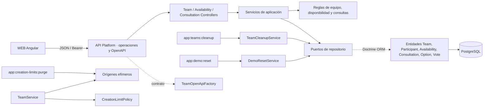
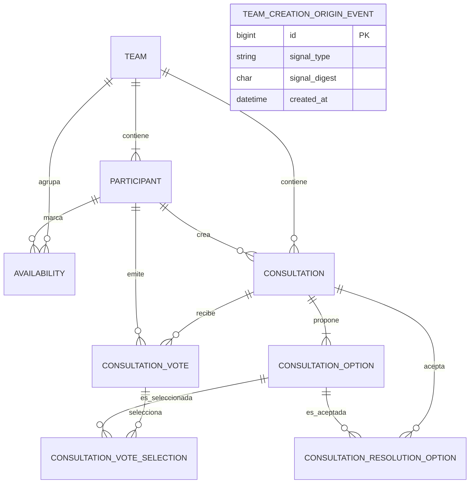

# Arquitectura del módulo API

La API usa PHP 8.5, Symfony 7.4, API Platform 5, Doctrine ORM y PostgreSQL 18. Permite crear equipos y publica operaciones protegidas para leerlos, incorporar participantes, gestionar disponibilidad y crear, votar, consultar y resolver consultas.

## Componentes y responsabilidades

- **Recursos y controladores:** `TeamOperations`, `AvailabilityOperations` y `ConsultationOperations` declaran las rutas. Sus controladores adaptan JSON, Bearer y respuestas HTTP; `TeamOpenApiFactory` publica el contrato y `ProblemDetailsSubscriber` gestiona errores inesperados.
- **Equipo:** `TeamService` crea y lee equipos, incorpora participantes y verifica el enlace. `ParticipantName`, `TeamTimeZone` y `ExpiryCalculator` contienen reglas comprobables del dominio.
- **Correo de creación por entorno:** `/api/configuration` publica el modo efectivo `hidden`, `demo` o `send`. La variable `TEAM_CREATION_EMAIL_MODE` lo ajusta independientemente; vacío conserva el default por entorno (`send` en desarrollo y `hidden` en preproducción/producción/pruebas). `demo` muestra un aviso en WEB, pero API rechaza direcciones y no crea intentos; solo `send` admite y procesa correo mediante `MAILER_DSN`.
- **Límite de creación:** `CreationLimitPolicy` deriva el máximo y la ventana del entorno (`development`/`preproduction`: 2 equipos/60 minutos; `production`: 5/120) y permite sobrescribirlos independientemente con `TEAM_CREATION_LIMIT` y `TEAM_CREATION_WINDOW_MINUTES`. La creación cuenta señales de IP confiables y/o la clave aleatoria de dispositivo `X-Creation-Device`; si cualquiera supera el límite, responde `429`. En producción, la IP reenviada solo se acepta cuando Symfony identifica un proxy configurado como confiable; hasta verificar el proxy, se utiliza la señal first-party disponible. La transacción registra únicamente digests HMAC de las señales y su fecha, sin guardar IP/dispositivo ni asociarlos a un equipo. `app:creation-limits:purge` elimina eventos vencidos; la comprobación de creación también limpia los vencidos.
- **Presentación demo:** `DEMO_PANEL_ENABLED` controla de forma independiente si WEB muestra enlaces y avisos; vacío conserva el default del entorno (preproducción visible, otros entornos ocultos). `DEMO_RESET_SCHEDULE_ENABLED` indica si hay un Cron activo y solo entonces API publica `demo.nextResetAt`; activar la presentación localmente no crea un Cron.
- **Disponibilidad:** `AvailabilityService` lee el intervalo y guarda marcas de participante; `DailyAvailability` valida estados, fechas editables y resumen diario.
- **Consultas:** `ConsultationService` lista, crea, muestra el detalle, registra o retira votos por opción y resuelve consultas de texto o fechas. `TextConsultationRules` y `DateConsultationRules` validan las opciones de creación. Las mutaciones comprueban acceso, identidad y vigencia bajo bloqueo del equipo; el repositorio aplica las restricciones de voto y resolución.
- **Envío opcional del enlace (ADR-EQU-002):** `TeamService` cifra dirección y token con `SodiumPayloadCipher` (clave `MAIL_EVENT_KEY`) y guarda equipo, participante y evento `team_mail_attempt` en una transacción; la respuesta añade `mailAttempt` con un recibo aleatorio del que solo se guarda el SHA-256. El comando `app:mail:process` (servicio `mail-worker`) ejecuta `MailAttemptProcessor`: reclama un evento con `FOR UPDATE SKIP LOCKED`, confirma `started` antes de llamar a `SymfonyTeamLinkMailer` (una sola llamada SMTP, sin reintentos), registra `succeeded` o `failed` y borra el contenido cifrado; los eventos pendientes o iniciados que superan `MAIL_EVENT_TTL_SECONDS` se cierran como `failed` sin llamar al proveedor. `EmailLayout` y `TeamLinkMessage` componen el HTML y el texto. `MailAttemptStatusService` solo devuelve el estado; `succeeded` significa aceptación por el transporte, no entrega al buzón.
- **Persistencia y limpieza:** los repositorios `Orm*Repository` implementan los puertos de aplicación con Doctrine. `TeamCleanupService`, `TeamDeletionPolicy` y el comando `app:teams:cleanup` eliminan de la base activa los equipos cuyo plazo de retención terminó. El comando requiere ejecución externa; no hay tarea programada en el repositorio.
- **Juego demo:** `app:demo:reset` solo elimina datos dependientes de las dos raíces UUID declaradas en `DEMO_TEAM_IDS`, valida sus credenciales derivadas del secreto propio del entorno y rota la generación/token en una transacción. Conserva las raíces y todos los equipos reales. `--initialize` solo añade el fixture demo; en cualquier modo no interactivo se requieren `--force --no-interaction`. En local, incluso al simular otro entorno, la conexión se restringe a PostgreSQL local. Remoto exige host privado exacto; producción admite cualquier proveedor y la comprobación no depende de Railway. El Cron de preproducción sigue en IaC y puede habilitarse aparte; producción puede invocar el mismo comando desde cualquier scheduler, sin infraestructura de producción declarada aquí.

## Operaciones actuales

| Recurso | Operaciones |
|---|---|
| Configuración pública | `GET /api/configuration`: devuelve `teamCreationEmailMode`, `teamCreationMaxTeams`, `teamCreationWindowMinutes` y el estado de presentación demo; `demo.nextResetAt` solo aparece si el Cron está habilitado; respuesta `no-store` |
| Equipo | `POST /api/teams` (con `email` opcional y `X-Creation-Device` opcional), `GET /api/teams/current`, `POST /api/teams/current/participants`; la creación puede responder `429` si una señal supera el límite |
| Envío del enlace | `GET /api/mail-attempts/current`: estado `pending`, `succeeded` o `failed`, identificado por el recibo en la cabecera `X-Mail-Receipt` |
| Disponibilidad | `GET /api/teams/current/availability`, `PUT /api/teams/current/availability/{date}/participants/{participantId}` |
| Consultas | `GET /api/teams/current/consultations`, `POST /api/teams/current/consultations` para opciones de texto o fecha, `GET /api/teams/current/consultations/{consultationId}` |
| Votos y resolución | `PUT /api/teams/current/consultations/{consultationId}/votes/{participantId}/options/{optionId}`, `PUT /api/teams/current/consultations/{consultationId}/resolution` |

Las rutas del equipo vigente comprueban el Bearer del enlace. Las respuestas son JSON o Problem Details y se describen en `/api/docs`.

## Listados de consultas y eventos por vigencia

`GET /api/teams/current/consultations` y `GET /api/teams/current/events` devuelven `active`, `archived`, `archivedCursor` y `listContext` (`today`, `timeZone`, `recentDays`, `loadMoreCount`). Los resúmenes añaden `effectiveDate` como fecha civil; conservan el estado y el tipo persistidos. Las clasificaciones corresponden a [RF-CON-008 — Listar consultas por vigencia](../../pdi_doc/03_requisitos/01_funcionales/CON/rf-con-008-listar-consultas-vigencia.md) y [RF-EVT-002 — Listar y consultar eventos](../../pdi_doc/03_requisitos/01_funcionales/EVT/rf-evt-002-listar-consultar-eventos.md).

La primera lectura incluye todas las activas y todas las archivadas de la ventana reciente, sin limitar esta última al tamaño de página. Con `?archivedCursor=...`, la continuación devuelve solo `archived`, el siguiente cursor o `null` y el contexto. La WEB conserva las activas y concatena el historial. `Application/Listing/ListPolicy` centraliza los valores iniciales de siete días civiles y diez elementos adicionales; el servidor publica los valores efectivos, sin duplicar la política en la WEB.

El servicio autoriza primero el equipo y obtiene el día de su zona con el reloj inyectado. El repositorio proyecta la clasificación y fecha, aplica filtros, orden y límite en PostgreSQL y solo hidrata los resúmenes seleccionados. El orden usa día ASC para activas y DESC para archivadas, con ID ASC como desempate. No se persisten pseudoestados ni vigencia. Se preservan las zonas válidas de PHP, incluidos alias y offsets fijos: los offsets se trasladan a PostgreSQL como intervalos de segundos para evitar interpretar sus signos con reglas POSIX.

El cursor versionado vincula recurso, equipo, contexto y frontera de fecha/ID; no contiene ni reemplaza la credencial Bearer. Un cursor inválido devuelve `400`; un cambio de día o zona devuelve `409` con `urn:synqo:problem:list-context-changed` y obliga a recargar la ventana inicial. Los datos entre peticiones son vivos; crear, editar, resolver, rechazar o recuperar invalida el cursor del cliente. Las operaciones de escritura conservan sus restricciones y transacciones.

La lista de eventos añade `openConsultationId` (UUID o `null`), derivado de `consultation.open_event_id` en una lectura filtrada por equipo. El selector de vínculo usa este campo en lugar de deducir ocupación del historial paginado: una consulta abierta archivada sigue ocupando su evento aunque no esté en la ventana cargada. El resumen de lista tiene esquema propio; los eventos embebidos o de detalle conservan su contrato. `/events/calendar` conserva su proyección independiente de eventos fechados.

La vigencia de un evento rechazado procede de `lastModifiedAt`, que el rechazo siempre actualiza. Si un rechazado carece de ese momento, la lectura detecta la inconsistencia y devuelve el error genérico registrado por el manejador de excepciones; no inventa una fecha ni oculta el evento. Recuperar conserva la fecha del evento y devuelve su estado provisional, incluso cuando esa fecha ha pasado.

## Persistencia

Las migraciones en `apps/api/migrations/` crean diez tablas: equipo, participante, disponibilidad, consulta, opción, voto, selección de voto, opción aceptada en la resolución, evento de envío del enlace (`team_mail_attempt`, sin dirección ni token tras finalizar) y evento de origen para limitar la creación (`team_creation_origin_event`). Esta última tabla no tiene clave foránea a equipos y sólo guarda tipo de señal, digest HMAC y fecha de creación; la purga elimina señales fuera de la ventana configurada. Cada opción de consulta guarda texto **o** fecha civil, con una restricción que exige exactamente uno de esos valores. La consulta conserva el participante y la fecha de resolución. Las claves foráneas aplican borrado en cascada desde el equipo; la cascada para votos y resoluciones quedó verificada en [SPEC-EQU-002 — Borrado de equipos caducados](../../pdi_doc/08_especificaciones/99_archivadas/spec-equ-002-borrado-equipo-caducado.md).

## Operaciones locales

El reset manual se ejecuta con `php bin/console app:demo:reset` desde API. En local requiere `APP_ENV=dev`, PostgreSQL local y los UUID demo configurados; pide confirmación y nunca elimina equipos reales. Para probar otros valores de presentación, `SYNQO_DEPLOYMENT_ENV` puede simular preproducción/producción sin cambiar la guarda de conexión local. El README de API describe la inicialización y los ejemplos.

## Runtime de preproducción Railway

En REL-002, Symfony se ejecuta en FrankenPHP/Caddy junto a los assets de WEB, en la misma imagen y dominio público. Caddy pasa `/api` y `/api/...` al front controller PHP; las rutas API desconocidas deben conservar el error Symfony/API y no responder con el fallback Angular. El runtime normal de peticiones de FrankenPHP se usa sin worker mode. `PORT` controla el listener y `/healthz` es un healthcheck HTTP básico, no una prueba de conectividad PostgreSQL.

El servicio Railway referencia `DATABASE_URL` del PostgreSQL gestionado y ejecuta `doctrine:migrations:migrate --no-interaction` como paso pre-deploy de cada despliegue automático desde `main`. Doctrine fija `server_version: '18'` en la configuración de API porque la URL de Railway no incluye ese parámetro; debe mantenerse sincronizado con PostgreSQL 18 en IaC y Compose. Antes de integrar cambios en `main`, se revisan las migraciones pendientes y sus efectos; volver a una imagen anterior no revierte una migración ni restaura datos. En preproducción el correo queda oculto y desactivado (`TEAM_CREATION_EMAIL_MODE=hidden`, `MAILER_DSN=null://null`). El procedimiento operativo está en el runbook de despliegue de REL-002.

Las rutas `/api/*` permanecen bajo Symfony/API Platform y no reciben el fallback SPA. Las rutas desconocidas devuelven Problem Details JSON con `404`; `/api` se reserva para el endpoint de documentación de API Platform.

## Desarrollo

El paquete Composer se identifica como `synqo/api` con metadato `proprietary` para las aportaciones propias. `apps/api/LICENSE` conserva el aviso MIT de Symfony Skeleton; no licencia toda Synqo. El staging de producción preserva el vendor íntegro y añade los avisos propios y agregados de terceros mediante el [procedimiento de distribución](../legal/procedencia-y-avisos.md).

Los comandos de Composer, migraciones, limpieza, base de prueba y análisis estático están en el [README principal](../../README.md#desarrollo-local). Los scripts ejecutables se declaran en `apps/api/composer.json`.
